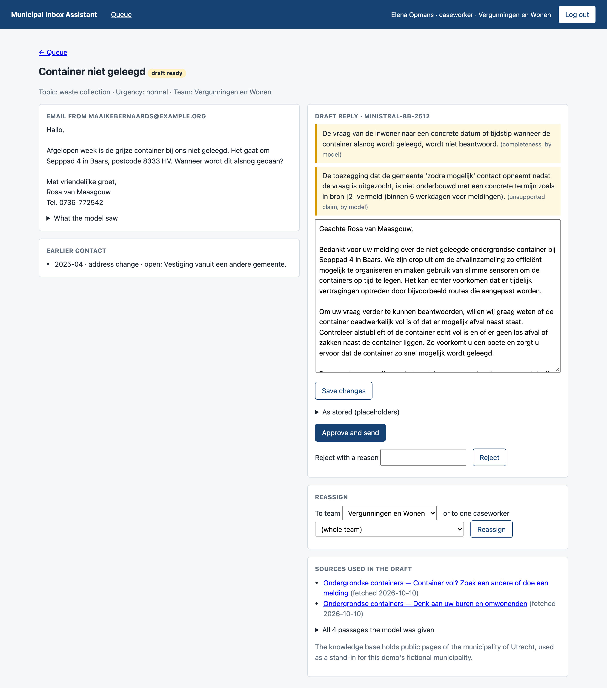
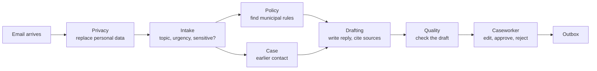
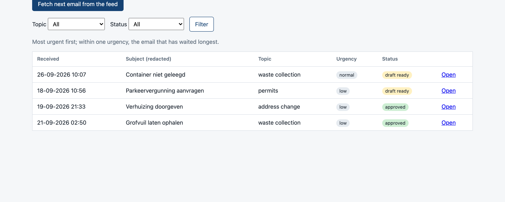
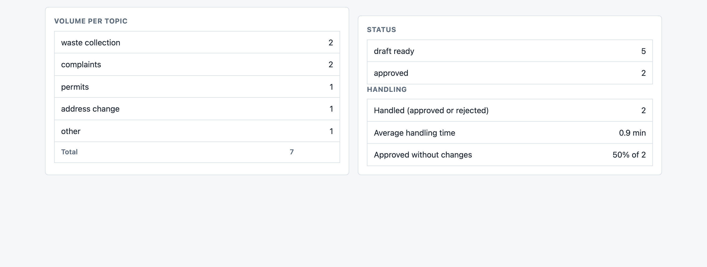
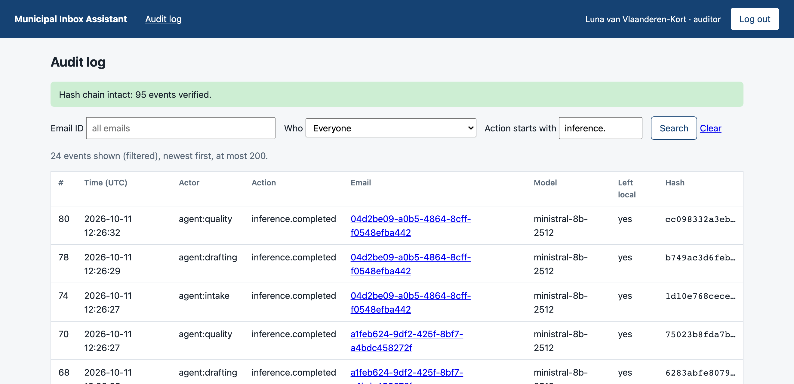

# Municipal Inbox Assistant

[](https://github.com/freddy24-7/MuniMailbox/actions/workflows/ci.yml)

An AI assistant that drafts replies to citizen emails for a (fictional) Dutch municipality.
Personal data is removed before any language model sees the email, every draft cites the
municipal pages it is based on, and a civil servant approves each reply before it is sent.

It is a portfolio project built to work through one question: **how do you use language
models on mail that is full of personal data, without having to trust the model?**



*The review page. A caseworker sees the real names; the model only ever saw placeholders
such as `[PERSON_1]`. The yellow notes are an automatic check telling the caseworker what
to look at before approving. All people, addresses and numbers in this project are synthetic.*

## What it does

An email goes through six small steps, each with one job:



1. **Privacy** replaces names, addresses, citizen service numbers (BSN), bank accounts,
   phone numbers and more with placeholders. The mapping is stored encrypted.
2. **Intake** classifies the email by topic and urgency, flags threats or distress, and
   routes it to the right team.
3. **Policy** searches a knowledge base of municipal web pages for the passages that
   answer the question. **Case** looks up the sender's earlier contact. These two run at
   the same time.
4. **Drafting** writes a reply in Dutch from the redacted email, the passages and the case
   history, and states which passages it used.
5. **Quality** checks the draft: rule-based checks for numbers and amounts that are in no
   source, and a second model call for tone, completeness and unsupported claims.
6. **A caseworker** sees the email with the personal data restored, edits if needed, and
   approves or rejects. Only an approved reply reaches the (simulated) outbox.

## What makes it more than a chatbot wrapper

- **Privacy is enforced by the structure of the code, not by convention.** There is exactly
  one way to reach a language model, the inference router, and it refuses any text that
  has no redaction record. Tests build the pipeline wrongly on purpose to prove the
  refusal holds, on the local route and on the cloud route.
- **The model cannot invent a source.** It is shown numbered passages without links and
  answers with numbers. The code looks up the title and link, and drops and reports any
  number that was not offered.
- **A person approves every reply.** There is one code path into the outbox, and it
  requires a review by a user with the caseworker role. A test reads the source code and
  fails if a second path appears.
- **Three roles see three different things.** The caseworker sees the person, the team lead
  sees the team's numbers, the auditor sees the process and never the person.
- **Every step is in a tamper-evident audit log.** Each record contains a hash of the one
  before it, and PostgreSQL itself rejects updates and deletes on that table.
- **Claims are measured.** Redaction, retrieval and test coverage each have a number
  behind them, including the ones that turned out less flattering than expected.

## Screenshots

| | |
| --- | --- |
|  |  |
| **Queue.** Most urgent first, then the email that has waited longest. Subjects are shown redacted. | **Team dashboard.** Volume per topic, handling time, and how many drafts were approved unchanged. |



*The audit log, filtered to model calls. "Left local: yes" means the call went to a cloud
model; the auditor can see that it did, and for which email, without seeing its content.*

## Measured results

| What | Result | How it was measured |
| --- | --- | --- |
| Personal data redacted | 99.9% of 1,485 labelled values | A generated test set of synthetic emails, including hard cases. CI fails below 95%. |
| Right page among the 4 retrieved passages | 83% of 29 questions | `scripts/evaluate_retrieval.py`, on citizen-style questions with a known answer page |
| Time from email to draft | about 5 to 7 seconds | Eight emails through the full pipeline, with the cloud model |
| Automated tests | 234 unit and integration tests, 3 browser tests | Run on PostgreSQL and Redis in CI |
| Test coverage | about 91% | CI fails below 70% |

Two findings worth stating plainly:

- **Hybrid search did not beat plain semantic search** on this test set. Both found the
  right page 83% of the time. The project keeps both methods callable separately so this
  can be re-measured as the knowledge base grows.
- **The redaction gate once reported 99.8% while missing half of all town names**, because
  towns were not labelled in the test set. The first real cloud run exposed it. The fix
  was to label them first, watch the number drop to 81.5%, and then repair the
  recognizers. What is not labelled is not measured.

## Tech stack

| Layer | Choice |
| --- | --- |
| Backend | Python 3.12, FastAPI, async throughout |
| Data | PostgreSQL, SQLAlchemy 2 (async), Alembic migrations |
| Events | Redis Streams, with an in-memory bus behind the same interface |
| Personal data | Microsoft Presidio, spaCy, custom Dutch recognizers (BSN with 11-check, postcodes, IBAN, phone numbers, place names) |
| Retrieval | ChromaDB, `bge-m3` embeddings, BM25 keyword search, reciprocal rank fusion |
| Models | Any OpenAI-compatible server: Ollama locally, Mistral as the cloud route |
| Frontend | Server-rendered Jinja2 templates with HTMX |
| Monitoring | Prometheus, Loki, Grafana, Grafana Alloy |
| Tests and CI | pytest, Playwright, ruff, mypy (strict), GitHub Actions |

## How it is built

```
app/
  agents/         one module per agent: privacy, intake, policy, case, drafting, quality
  orchestrator/   runs the workflow from events, with retries
  events/         event bus: Redis Streams and in-memory
  inference/      the router (the only door to a model), clients, prompt loading
  privacy/        recognizers, redaction and restoration, encryption, retention
  rag/            fetching, chunking, embeddings, hybrid retrieval, evaluation
  review/         approve, edit, reject, reassign; team statistics
  auth/           roles and permissions (one table), team scoping
  audit/          append-only, hash-chained audit log
  observability/  metrics, structured logs, correlation IDs
  web/            the review interface
prompts/          prompt templates (Dutch), versioned
tests/            unit, integration, PII test set, browser end-to-end
deploy/           Docker Compose, monitoring configuration, systemd units
cards/            concept notes written while building (see below)
```

A few design decisions, with the reasoning:

- **Agents are stateless and pass results through the database.** The drafting agent reads
  the passages from the email's row; it does not know a policy agent exists. Any step can
  be run again, which is what makes retries and crash recovery possible.
- **Events are delivered at least once, so every step is safe to receive twice.** A step
  that already ran is recognised by its audit record and skipped. The same check lets an
  email continue after the app dies between saving a step and announcing it.
- **Edits never overwrite the model's draft.** A caseworker's edit is stored next to it,
  and is redacted again before it is stored. That keeps "approved unchanged" a simple
  lookup and keeps clear-text personal data out of the drafts table.
- **Metrics carry no identifiers.** One email's journey is a question for the logs, by
  correlation ID; a metric label has a small, fixed set of values.

## Running it locally

You need [uv](https://docs.astral.sh/uv/), Docker, and [Ollama](https://ollama.com) with
an embedding model (`ollama pull bge-m3`). For the chat model, use a local one through
Ollama or a Mistral API key.

```bash
cp .env.example .env          # then fill in: two generated keys, model settings
docker compose up -d          # PostgreSQL, ChromaDB, Redis
uv sync
uv run alembic upgrade head
uv run python scripts/generate_synthetic.py --citizens 200 --emails 500
uv run python scripts/fetch_documents.py      # downloads the public pages
uv run python scripts/ingest_documents.py     # builds the knowledge base
uv run uvicorn app.main:app --reload          # http://localhost:8000
```

Log in as one of the generated demo users, press "Fetch next email from the feed", and
open the email once its status is "draft ready".

```bash
uv run pytest tests/unit tests/integration    # no Docker, no model needed
uv run pytest tests/pii_testset -s            # the redaction gate, with its report
uv run pytest tests/e2e                       # browser tests (first: uv run playwright install chromium)
docker compose --profile monitoring up -d     # Prometheus, Loki, Grafana on :3000
```

The tests replace the models and the vector store with fakes behind the same interfaces,
so the whole pipeline runs in a few seconds on a laptop.

## Limits and honest status

- **It is a demo, not a product.** The municipality is fictional and all citizens, cases
  and emails are generated. The knowledge base uses public pages of the municipality of
  Utrecht as a stand-in; this project is not affiliated with Utrecht.
- **The login has no passwords.** You pick a demo user. Authorization (who may do and see
  what) is real and tested; authentication is deliberately out of scope.
- **Draft quality depends on the model.** A small local model that fits in 8 GB of RAM
  could not produce usable replies, so the screenshots use a small Mistral model through
  the cloud route. Its drafts are fluent but often too general, which is exactly what the
  quality warnings in the screenshot are pointing out.
- **Redaction is not perfect.** A village mentioned without a preposition or postcode, or
  an unusual first name, can still be missed. The test set shows which.
- **Deployment is written but not run.** The systemd units, HTTPS proxy configuration and
  deploy script in `deploy/` have not been run on a real server.

## How it was built

The project started from a requirements document ([docs/PRD.md](docs/PRD.md)) and was
built in six stages, each ending with working software and its tests. I built it together
with Claude Code as a pair programmer, and used each stage to study the concepts behind
it. The notes from that are in [cards/](cards/): one card per concept, with what was
decided and why, what was seen in practice, and what is still open.
